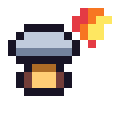

<div align="center">

# 🎯 09 - The Prototype

### İki kullanıcılı sayı tahmin ve konum kilitleme prototipi (`while` döngüleri ve `Console.Clear`).


-blue?style=for-the-badge)


[🇬🇧 English](README.md) · 🇹🇷 Türkçe

</div>

---

## 🎯 Kitaptaki Görev (Challenge: The Prototype — 100 XP)

**Level 11 — Looping:**
Consolas Muhafızları kaptanı Mylara, Uncoded One'ın hava gemisini takip edebilmek için bir konum belirleme prototipi hazırlamanı ister. Hava gemisi pilotunu temsil eden 1. kullanıcı `0` ile `100` arasında bir sayı seçer. Ardından ekran temizlenir ve avcıyı temsil eden 2. kullanıcı doğru sayıyı bulana kadar tahminde bulunur:

```text
User 1, enter a number between 0 and 100: 27
```
*(Bu sayı girildikten sonra ekran temizlenir ve şöyle devam eder:)*
```text
User 2, guess the number.
What is your next guess? 50
50 is too high.
What is your next guess? 25
25 is too low.
What is your next guess? 27
You guessed the number!
```

### Hedefler (Objectives):
- Pilotun (1. kullanıcı) bir sayı girmesine izin veren bir program oluşturmak.
- Sayı `100`'den büyük veya `0`'dan küçükse geçerli bir sayı girilene kadar sormaya devam etmek.
- Geçerli bir sayı alındıktan sonra ekranı temizlemek (`Console.Clear()`).
- İkinci kullanıcıdan (avcı) sayı tahmin etmesini istemek.
- Kullanıcının tahmininin çok yüksek (`too high`), çok düşük (`too low`) veya doğru olduğunu bildirmek.
- Doğru tahmin edilene kadar döngüyü sürdürmek ve bulunduğunda programı sonlandırmak.

---

## 🛠️ Nasıl Yaptım? (Mimari ve Uygulama Detayları)

- **Aralık Doğrulama Döngüsü:** İlk `while (true)` döngüsünde 1. kullanıcının girdiği `NumberlOfLocation` değerinin `0` ile `100` arasında olup olmadığını (`NumberlOfLocation < 0 || NumberlOfLocation > 100`) kontrol ettim; geçerliyse `break` ile döngüden çıktım.
- **Ekran Gizleme:** 2. kullanıcının hedef sayıyı görmemesi için `Console.Clear()` ile konsol ekranını temizledim.
- **Tahmin Döngüsü:** İkinci `while (true)` döngüsünde 2. kullanıcının tahminini (`GUessOfLocation`) hedef sayıyla karşılaştırarak düşükse `"too low"`, yüksekse `"too high"` ipucu verdim ve eşitlik sağlandığında `"You guessed it!"` yazdırarak programı sonlandırdım.

---

## 📁 Dosyalar

- [`Program.cs`](Program.cs) — İki oyunculu hedef tahmin prototipi (`LevelTask.Task09.Program.Main`)

<!-- RPG-NAV -->
---

<div align="center">

[⬅️ 08 - Buying & Discounted Inventory](../08-Buying-and-Discounted-Inventory/README-tr.md) &nbsp;·&nbsp; [🏠 Ana Görev Günlüğü](../../../README-tr.md) &nbsp;·&nbsp; [10 - The Magic Cannon ➡️](../10-The-Magic-Cannon/README-tr.md)

</div>
