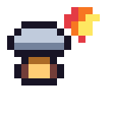

<div align="center">

# 🎯 09 - The Prototype

### Two-player range-finding number guessing prototype using validation loops and `Console.Clear()`.


🇬🇧 English · [🇹🇷 Türkçe](README-tr.md)

</div>

---

## 🎯 The Challenge (The Prototype — 100 XP)

**Level 11 — Looping:**
Mylara, captain of the Guard of Consolas, asks you to build a range-finding prototype to help track down The Uncoded One's airship. One user (representing the airship pilot) picks a number between `0` and `100`. The screen is then cleared, and a second user (the hunter) repeatedly guesses until they find the exact number:

```text
User 1, enter a number between 0 and 100: 27
```
*(After entering this number, the screen clears and continues like this:)*
```text
User 2, guess the number.
What is your next guess? 50
50 is too high.
What is your next guess? 25
25 is too low.
What is your next guess? 27
You guessed the number!
```

### Objectives:
- Allow User 1 (the pilot) to enter a number.
- Keep asking if the number is above `100` or less than `0`.
- Clear the screen (`Console.Clear()`) once a valid number has been collected.
- Ask a second user (the hunter) to guess numbers.
- Indicate whether the user guessed too high, too low, or guessed right.
- Loop until they get it right, then end the program.

---

## 🛠️ How I Built It (Architecture & Implementation Details)

- **Input Bounds Loop:** Used a `while (true)` loop to validate that User 1's target location (`NumberlOfLocation`) falls within `[0, 100]`, re-prompting whenever `NumberlOfLocation < 0 || NumberlOfLocation > 100`.
- **Screen Clearing:** Called `Console.Clear()` immediately after validating User 1's input so User 2 cannot see the target number.
- **Hunter Feedback Loop:** Used a second `while (true)` loop comparing `GUessOfLocation` against `NumberlOfLocation`, printing `"too low"` or `"too high"` until the exact number is guessed.

---

## 📁 Files

- [`Program.cs`](Program.cs) — Two-player range-finding prototype (`LevelTask.Task09.Program.Main`)

<!-- RPG-NAV -->
---

<div align="center">

[⬅️ 08 - Buying & Discounted Inventory](../08-Buying-and-Discounted-Inventory/README.md) &nbsp;·&nbsp; [🏠 Quest Log Hub](../../../README.md) &nbsp;·&nbsp; [10 - The Magic Cannon ➡️](../10-The-Magic-Cannon/README.md)

</div>
