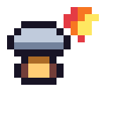

<div align="center">

# 💥 10 - The Magic Cannon

### Elemental cannon blast classifier (`Normal`, `Fire`, `Electric`, `Combined`) using modulo arithmetic and nested ternary expressions.


🇬🇧 English · [🇹🇷 Türkçe](README-tr.md)

</div>

---

## 🎯 The Challenge (The Magic Cannon — 100 XP)

**Level 11 — Looping:**
Skorin, a member of Consolas's wall guard, has constructed a magic cannon powered by a fire gem and an electric gem:
- Every **3rd** turn of the crank, the fire gem activates and the cannon produces a **`Fire`** blast.
- Every **5th** turn of the crank, the electric gem activates and the cannon produces an **`Electric`** blast.
- When the two line up (every **15th** turn), it produces a potent **`Combined`** blast.
- On all other turns, the cannon produces a **`Normal`** shot.

### Objectives:
- Loop through the turns and use the remainder operator (`%`) to report which type of blast the crew should expect on each turn.

---

## 🛠️ How I Built It (Architecture & Implementation Details)

- Used a `do-while` loop to prompt the user for a valid upper turn count (`blast`) between `0` and `100`.
- Inside the `for (int i = 0; i < blast; i++)` loop, evaluated divisibility by `15` (both 3 and 5), `3`, and `5` in a single expression using **nested ternary (`? :`) operators** instead of verbose `if-else` chains:
  ```csharp
  Console.WriteLine($"{i}.{(i % 15 == 0 ? "combined blast" : i % 3 == 0 ? "Fire" : i % 5 == 0 ? "Electric" : "Normal")}");
  ```

---

## 📁 Files

- [`Program.cs`](Program.cs) — Elemental cannon blast calculator (`LevelTask.Task10.Program.Main`)

<!-- RPG-NAV -->
---

<div align="center">

[⬅️ 09 - The Prototype](../09-The-Prototype/README.md) &nbsp;·&nbsp; [🏠 Quest Log Hub](../../../README.md) &nbsp;·&nbsp; [11 - The Replicator of D'To ➡️](../11-The-Replicator-of-DTo/README.md)

</div>
