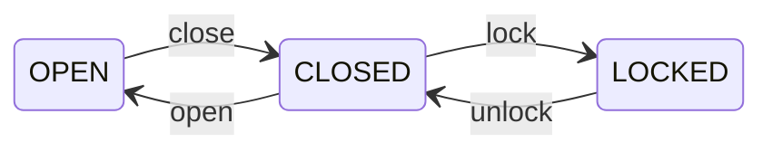

<div align="center">

# 🔒 15 - Simula's Test

### Sandığın durumlarını (`Locked`, `Unlocked`, `Opened`) `enum` ve `Enum.TryParse` ile modelleyen durum kontrol uygulaması.


-blue?style=for-the-badge)


[🇬🇧 English](README.md) · 🇹🇷 Türkçe

</div>

---

## 🎯 Kitaptaki Görev (Challenge: Simula's Test — 100 XP)

**Level 16 — Enumerations:**
Enumerant köyünde Simula sana kilitli küçük bir sandık uzatır. Sandığın kapağı açık (`Open`), kapalı ama kilitsiz (`Closed`) veya kilitli (`Locked`) olabilir. Bu durumlar arasındaki geçiş mekanizmasını bir `enum` kullanarak yeniden oluşturman gerekir:



```text
The chest is locked. What do you want to do? unlock
The chest is unlocked. What do you want to do? open
The chest is open. What do you want to do? close
The chest is unlocked. What do you want to do?
```

### Hedefler (Objectives):
- Sandığın durumunu temsil eden bir `enum` tanımlamak.
- Türü bu yeni `enum` olan bir değişken oluşturmak.
- Sandığı `lock`, `unlock`, `open` ve `close` komutlarıyla yöneten, ancak desteklenmeyen durum geçişlerine izin vermeyen kod yazmak.
- Sonsuz döngüde bir sonraki komutu istemek.

---

## 🛠️ Nasıl Yaptım? (Mimari ve Uygulama Detayları)

- Sandığın üç temel durumunu temsil eden `ChestStatusEnum` (`Locked`, `Unlocked`, `Opened`) veri tipini tanımladım.
- Kullanıcının konsoldan girdiği metni büyük/küçük harf duyarsız (`ignoreCase: true`) olarak `Enum.TryParse<ChestStatusEnum>(input, true, out ChestStatusEnum chestStatus)` metoduyla güvenli şekilde `enum` değerine dönüştürdüm.
- `switch (chestStatus)` yapısı ile sandığın her bir durumuna karşılık gelen eylem mesajını ekrana yazdırdım; geçersiz bir metin girildiğinde ise programı çökertmeden uyarı mesajı verdim.

---

## 📁 Dosyalar

- [`Program.cs`](Program.cs) — `ChestStatusEnum` ve durum kontrol döngüsü (`LevelTask.Task15.Program.Main`)

<!-- RPG-NAV -->
---

<div align="center">

[⬅️ 14 - Hunting the Manticore](../14-Hunting-the-Manticore/README-tr.md) &nbsp;·&nbsp; [🏠 Ana Görev Günlüğü](../../../README-tr.md) &nbsp;·&nbsp; [16 - Simula's Soup ➡️](../16-Simulas-Soup/README-tr.md)

</div>
