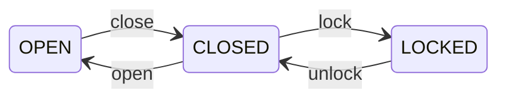

<div align="center">

# 🔒 15 - Simula's Test

### Chest state modeling (`Locked`, `Unlocked`, `Opened`) using custom `enum` definitions and case-insensitive `Enum.TryParse`.


🇬🇧 English · [🇹🇷 Türkçe](README-tr.md)

</div>

---

## 🎯 The Challenge (Simula's Test — 100 XP)

**Level 16 — Enumerations:**
In the village of Enumerant, Simula hands you a small locked chest whose lid can be `Open`, `Closed` (unlocked), or `Locked`. You need to recreate its state mechanism using an enumeration:



```text
The chest is locked. What do you want to do? unlock
The chest is unlocked. What do you want to do? open
The chest is open. What do you want to do? close
The chest is unlocked. What do you want to do?
```

### Objectives:
- Define an enumeration for the state of the chest.
- Create a variable whose type is this new enumeration.
- Write code to manipulate the chest while preventing unsupported state transitions.
- Loop indefinitely, prompting for the next command.

---

## 🛠️ How I Built It (Architecture & Implementation Details)

- Defined `ChestStatusEnum` with `Locked`, `Unlocked`, and `Opened` states.
- Used `Enum.TryParse<ChestStatusEnum>(input, ignoreCase: true, out ChestStatusEnum chestStatus)` inside an infinite `while (true)` loop to safely parse user input without throwing exceptions on invalid strings.
- Evaluated the parsed `chestStatus` with a `switch` statement to report the corresponding chest state and available actions.

---

## 📁 Files

- [`Program.cs`](Program.cs) — `ChestStatusEnum` and state inspection loop (`LevelTask.Task15.Program.Main`)

<!-- RPG-NAV -->
---

<div align="center">

[⬅️ 14 - Hunting the Manticore](../14-Hunting-the-Manticore/README.md) &nbsp;·&nbsp; [🏠 Quest Log Hub](../../../README.md) &nbsp;·&nbsp; [16 - Simula's Soup ➡️](../16-Simulas-Soup/README.md)

</div>
