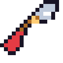

<div align="center">

# 🏹 17 - Vin Fletcher's Arrows

### Unified `Arrow` class combining 4 consecutive book challenges (Classes, Information Hiding, Properties, and Static members).


-success?style=for-the-badge)


🇬🇧 English · [🇹🇷 Türkçe](README-tr.md)

</div>

---

## 🎯 The Challenges (4-Part Quest Line — 350 XP Total)

This folder combines **four consecutive arrow-making challenges** spanning Levels 18 through 21 of *The C# Player's Guide* into a single encapsulated `Arrow` class:

### 1. Vin Fletcher's Arrows (Level 18 — Classes | 100 XP)
Build an `Arrow` class for master arrow maker Vin Fletcher that calculates arrow cost based on its components:

| Component | Options & Costs |
|---|---|
| **Arrowhead** | `Steel` (**10 gold**), `Obsidian` (**5 gold**), `Wood` (**3 gold**) |
| **Fletching** | `Plastic` (**10 gold**), `Turkey Feathers` (**5 gold**), `Goose Feathers` (**3 gold**) |
| **Shaft Length** | `60 cm` to `100 cm` — **`0.05 gold`** per centimeter |

### 2. Vin's Trouble (Level 19 — Information Hiding | 50 XP)
Protect the `Arrow` class fields with `private` access modifiers so external code cannot tamper with an arrow's specifications after creation.

### 3. The Properties of Arrows (Level 20 — Properties | 100 XP)
Replace verbose `Get`/`Set` methods with idiomatic C# **Properties** (`get; private set;` and validated `set` blocks).

### 4. Arrow Factories (Level 21 — Static | 100 XP)
Use `static` members and methods to manage class-wide constraints and standard arrow configurations:
- **Elite Arrow:** `Steel` arrowhead, `Plastic` fletching, `95 cm` shaft
- **Beginner Arrow:** `Wood` arrowhead, `Goose Feathers` fletching, `75 cm` shaft
- **Marksman Arrow:** `Steel` arrowhead, `Goose Feathers` fletching, `65 cm` shaft

---

## 🛠️ How I Built It (Architecture & Implementation Details)

### 1. Direct Cost Encoding in Enum Values (`: int`)
Instead of writing repetitive `switch-case` blocks inside `GetCost()`, I assigned the exact gold cost to the underlying integer values of `ArrowHeadTypeEnum` and `FletchingTypeEnum`:
```csharp
enum ArrowHeadTypeEnum : int { Steel = 10, WOOD = 3, Obsidian = 5 }
enum FletchingTypeEnum : int { Plastic = 10, TurkeyFeathers = 5, GooseFeathers = 3 }
```
This allows `GetCost()` to compute the total price in `O(1)` time via `(int)ArrowHeadType + (int)FletchingType + (ShaftLength * 0.05f)`.

### 2. Range Validation in Property Setter (`ArgumentOutOfRangeException`)
`ShaftLength` encapsulates `_shaftLength` and validates that any assigned value falls between `MinShaftLength` (`60`) and `MaxShaftLength` (`100`), throwing an `ArgumentOutOfRangeException` on invalid lengths.

### 3. Static Constraint Configuration (`ChangeMinShaftLenght`)
Added `public static void ChangeMinShaftLenght(int newMinShaftLength)` to safely update the class-wide `private static int MinShaftLength` boundary at runtime with bounds checking.

---

## 📁 Files

- [`Program.cs`](Program.cs) — `Arrow` class and cost-encoded enums (`LevelTask.Task17.Program.Main`)

<!-- RPG-NAV -->
---

<div align="center">

[⬅️ 16 - Simula's Soup](../16-Simulas-Soup/README.md) &nbsp;·&nbsp; [🏠 Quest Log Hub](../../../README.md) &nbsp;·&nbsp; [18 - The Point ➡️](../18-The-Point/README.md)

</div>
